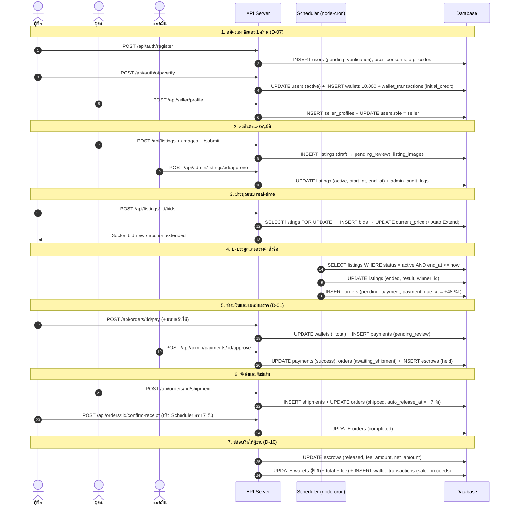

# ERD (เจ้าของ: SA)

- **`schema.sql`** โครงสร้างตารางทั้งระบบ (MySQL 8) **ไฟล์หลักที่ AI และทุกคนอ้างอิง**
- ER diagram และ Sequence diagram ด้านล่างใช้ประกอบเอกสารส่งอาจารย์ (ER diagram สร้างจาก `schema.sql` ถ้าแก้ schema ให้สร้างใหม่ด้วย)
- สร้างฐานข้อมูลในเครื่อง: `cd backend && npm run db:init` (ลบข้อมูลเดิมทั้งหมด แล้วใส่ seed จาก `backend/seeds/`)

## กติกา

- ชื่อตารางและคอลัมน์ใช้ `snake_case` ชื่อตารางเป็นพหูพจน์ API แปลงเป็น `camelCase`
- id ทุกตารางเป็น `BIGINT UNSIGNED AUTO_INCREMENT` (D-12)
- เวลาเก็บเป็น UTC (`DATETIME`) เงินเป็น `DECIMAL(12,2)` ห้ามใช้ FLOAT
- สถานะเป็นค่าภาษาอังกฤษตัวเล็ก ชื่อภาษาไทยแปลงที่ FE
- แก้ schema ต้องแก้ `schema.sql` + `docs/api-spec/api-spec.md` ใน PR เดียวกัน และแจ้งในกลุ่ม

## ตารางทั้งหมด (28 ตาราง)

| กลุ่ม | ตาราง | เจ้าของโมดูล |
| --- | --- | --- |
| สมาชิกและความปลอดภัย | users, user_consents, otp_codes, user_tokens, sessions | SA |
| Settings | addresses, notification_settings | PM |
| ผู้ขายและสินค้า | seller_profiles, categories, listings, listing_images | QA |
| ประมูล | bids, proxy_bids, watchlists | Programmer |
| คำสั่งซื้อและการเงิน | orders, payments, wallets, wallet_transactions, escrows | SA (orders สร้างโดย Programmer) |
| จัดส่ง | shipments | PM |
| ข้อพิพาทและบทลงโทษ | disputes, dispute_evidence, penalties, blacklists, suspicious_flags | QA |
| แจ้งเตือนและแอดมิน | notifications, admin_audit_logs, system_settings | PM |

## สถานะหลัก

| ตาราง.คอลัมน์ | ค่า | อ้างอิง |
| --- | --- | --- |
| users.status | pending_verification, active, restricted, suspended, banned | D-03 |
| users.role | bidder, seller, admin, super_admin | D-07 |
| listings.status | draft, pending_review, rejected, active, ended, cancelled | 1.7-1 |
| listings.result | has_winner, no_bid, below_reserve, buy_now | 1.7-2 |
| orders.status | pending_payment, awaiting_shipment, shipped, completed, disputed, cancelled | 1.7-3, D-08 |
| payments.status | pending_review, success, rejected (หมดเวลาดูจาก orders.cancel_reason) | 1.7-4, D-01 |
| escrows.status | held, released, refunded | 1.7-6, D-08 |
| disputes.status | open, awaiting_evidence, investigating, return_in_progress, refund_in_progress, closed | 1.7-7 |

## Sequence Diagram (flow หลัก)

## ER Diagram

```mermaid
erDiagram
    users {
        bigint id PK
        varchar email UK
        varchar username UK
        varchar password_hash
        varchar full_name
        varchar display_name
        varchar phone UK
        varbinary id_card_encrypted "nullable"
        char id_card_hash UK
        char id_card_last4 "nullable"
        varchar avatar_path "nullable"
        varchar bio "nullable"
        enum role "bidder|seller|admin|super_admin"
        enum status "pending_verification|active|restricted|suspended|banned"
        datetime status_until "nullable"
        varchar status_reason "nullable"
        datetime phone_verified_at "nullable"
        datetime email_verified_at "nullable"
        datetime activated_at "nullable"
        datetime last_login_at "nullable"
        datetime created_at
        datetime updated_at
    }
    user_consents {
        bigint id PK
        bigint user_id FK
        enum consent_type "terms_of_service|privacy_policy"
        varchar version
        varchar ip_address
        varchar user_agent "nullable"
        datetime accepted_at
    }
    otp_codes {
        bigint id PK
        bigint user_id FK
        char code_hash
        tinyint attempts
        datetime expires_at
        datetime used_at "nullable"
        datetime created_at
    }
    user_tokens {
        bigint id PK
        bigint user_id FK
        enum purpose "email_verify|password_reset"
        char token_hash UK
        datetime expires_at
        datetime used_at "nullable"
        datetime created_at
    }
    sessions {
        bigint id PK
        bigint user_id FK
        char token_hash UK
        varchar ip_address
        varchar user_agent "nullable"
        datetime created_at
        datetime last_seen_at
        datetime expires_at
        datetime revoked_at "nullable"
    }
    addresses {
        bigint id PK
        bigint user_id FK
        varchar recipient_name
        varchar phone
        varchar address_line
        varchar sub_district
        varchar district
        varchar province
        char postal_code
        tinyint is_default
        datetime created_at
        datetime updated_at
    }
    seller_profiles {
        bigint id PK
        bigint user_id FK,UK
        varchar shop_name
        varchar shop_description "nullable"
        varchar origin_province
        datetime created_at
        datetime updated_at
    }
    categories {
        bigint id PK
        bigint parent_id FK
        varchar name
        varchar slug UK
        int sort_order
    }
    listings {
        bigint id PK
        bigint seller_id FK
        bigint category_id FK
        varchar title
        text description
        varchar included_items "nullable"
        enum item_condition "new|used_good|defective"
        varchar defect_detail "nullable"
        decimal shipping_fee
        varchar origin_province
        decimal start_price
        decimal bid_increment
        decimal reserve_price "nullable"
        decimal buy_now_price "nullable"
        tinyint duration_days
        enum status "draft|pending_review|rejected|active|ended|cancelled"
        varchar reject_reason "nullable"
        datetime submitted_at "nullable"
        bigint reviewed_by FK
        datetime reviewed_at "nullable"
        datetime start_at "nullable"
        datetime end_at "nullable"
        tinyint extend_count
        decimal current_price "nullable"
        bigint current_bidder_id FK
        int bid_count
        enum result "has_winner|no_bid|below_reserve|buy_now"
        bigint winner_id FK
        datetime closed_at "nullable"
        datetime created_at
        datetime updated_at
    }
    listing_images {
        bigint id PK
        bigint listing_id FK
        varchar file_path
        tinyint is_cover
        tinyint sort_order
        datetime created_at
    }
    bids {
        bigint id PK
        bigint listing_id FK
        bigint bidder_id FK
        decimal amount
        enum bid_type "manual|proxy|buy_now"
        varchar ip_address "nullable"
        varchar user_agent "nullable"
        datetime created_at
    }
    proxy_bids {
        bigint id PK
        bigint listing_id FK
        bigint bidder_id FK
        decimal max_amount
        tinyint is_active
        datetime priority_at
        datetime created_at
        datetime updated_at
    }
    watchlists {
        bigint id PK
        bigint user_id FK
        bigint listing_id FK
        datetime ending_soon_notified_at "nullable"
        datetime created_at
    }
    orders {
        bigint id PK
        bigint listing_id FK,UK
        bigint buyer_id FK
        bigint seller_id FK
        enum closing_type "auction|buy_now"
        decimal item_price
        decimal shipping_fee
        decimal total_amount
        json shipping_address
        enum status "pending_payment|awaiting_shipment|shipped|completed|disputed|cancelled"
        datetime payment_due_at
        datetime payment_reminded_at "nullable"
        datetime paid_at "nullable"
        datetime ship_due_at "nullable"
        datetime ship_reminded_at "nullable"
        datetime shipped_at "nullable"
        datetime auto_release_at "nullable"
        datetime completed_at "nullable"
        datetime cancelled_at "nullable"
        enum cancel_reason "payment_timeout|seller_no_shipment|dispute_refund"
        datetime created_at
        datetime updated_at
    }
    payments {
        bigint id PK
        bigint order_id FK
        bigint payer_id FK
        decimal amount
        enum method "mock_wallet"
        enum status "pending_review|success|rejected"
        varchar slip_file_path "nullable"
        decimal slip_amount "nullable"
        datetime slip_transferred_at "nullable"
        varchar slip_reference "nullable"
        datetime slip_uploaded_at "nullable"
        bigint reviewed_by FK
        datetime reviewed_at "nullable"
        varchar reject_reason "nullable"
        datetime created_at
    }
    wallets {
        bigint id PK
        bigint user_id FK,UK
        decimal balance
        datetime created_at
        datetime updated_at
    }
    wallet_transactions {
        bigint id PK
        bigint wallet_id FK
        enum type "initial_credit|payment|payment_refund|sale_proceeds|escrow_refund"
        decimal amount
        decimal balance_after
        enum reference_type "order|payment|escrow"
        bigint reference_id "nullable"
        varchar note "nullable"
        datetime created_at
    }
    escrows {
        bigint id PK
        bigint order_id FK,UK
        decimal amount
        enum status "held|released|refunded"
        decimal fee_amount "nullable"
        decimal net_amount "nullable"
        datetime held_at
        datetime released_at "nullable"
        datetime refunded_at "nullable"
    }
    shipments {
        bigint id PK
        bigint order_id FK,UK
        enum carrier "thailand_post|kerry|flash|jt|other"
        varchar carrier_other "nullable"
        varchar tracking_number
        datetime shipped_at
        varchar proof_file_path "nullable"
        varchar note "nullable"
        datetime created_at
    }
    disputes {
        bigint id PK
        bigint order_id FK
        bigint opened_by FK
        enum type "not_received|not_as_described|damaged|other"
        text description
        varchar contact_info "nullable"
        enum status "open|awaiting_evidence|investigating|return_in_progress|refund_in_progress|closed"
        enum resolution "refund_buyer|release_seller"
        varchar admin_note "nullable"
        bigint resolved_by FK
        datetime resolved_at "nullable"
        bigint open_order_id UK
        datetime created_at
        datetime updated_at
    }
    dispute_evidence {
        bigint id PK
        bigint dispute_id FK
        bigint uploaded_by FK
        enum party "buyer|seller"
        varchar file_path
        varchar note "nullable"
        datetime created_at
    }
    penalties {
        bigint id PK
        bigint user_id FK
        enum type "non_payment|no_shipment|shill_bidding|admin_ban"
        bigint order_id FK
        enum action "warning|restrict|suspend|ban"
        datetime action_until "nullable"
        varchar note "nullable"
        bigint created_by FK
        datetime created_at
    }
    blacklists {
        bigint id PK
        bigint user_id FK
        char id_card_hash "nullable"
        varchar phone "nullable"
        varchar reason
        bigint created_by FK
        datetime created_at
        bigint revoked_by FK
        datetime revoked_at "nullable"
    }
    suspicious_flags {
        bigint id PK
        bigint listing_id FK
        bigint bidder_id FK
        bigint seller_id FK
        enum reason "same_ip|same_device|repeated_seller"
        varchar detail "nullable"
        bigint reviewed_by FK
        datetime reviewed_at "nullable"
        datetime created_at
    }
    notifications {
        bigint id PK
        bigint user_id FK
        varchar event
        varchar title
        varchar message
        varchar link_url "nullable"
        enum reference_type "listing|order|payment|dispute|user"
        bigint reference_id "nullable"
        datetime read_at "nullable"
        datetime emailed_at "nullable"
        datetime created_at
    }
    notification_settings {
        bigint id PK
        bigint user_id FK,UK
        tinyint auction_web
        tinyint auction_email
        tinyint finance_web
        tinyint finance_email
        tinyint shipping_web
        tinyint shipping_email
        datetime updated_at
    }
    admin_audit_logs {
        bigint id PK
        bigint admin_id FK
        varchar action
        varchar target_type
        varchar target_id
        json detail "nullable"
        varchar ip_address
        datetime created_at
    }
    system_settings {
        varchar setting_key PK
        varchar setting_value
        varchar description "nullable"
        bigint updated_by FK
        datetime updated_at
    }
    users ||--o{ addresses : "user_id"
    users ||--o{ admin_audit_logs : "admin_id"
    users ||--o{ bids : "bidder_id"
    listings ||--o{ bids : "listing_id"
    users ||--o{ blacklists : "created_by"
    users ||--o{ blacklists : "revoked_by"
    users ||--o{ blacklists : "user_id"
    categories ||--o{ categories : "parent_id"
    disputes ||--o{ dispute_evidence : "dispute_id"
    users ||--o{ dispute_evidence : "uploaded_by"
    users ||--o{ disputes : "opened_by"
    orders ||--o{ disputes : "order_id"
    users ||--o{ disputes : "resolved_by"
    orders |o--o| escrows : "order_id"
    listings ||--o{ listing_images : "listing_id"
    users ||--o{ listings : "current_bidder_id"
    categories ||--o{ listings : "category_id"
    users ||--o{ listings : "reviewed_by"
    users ||--o{ listings : "seller_id"
    users ||--o{ listings : "winner_id"
    users |o--o| notification_settings : "user_id"
    users ||--o{ notifications : "user_id"
    users ||--o{ orders : "buyer_id"
    listings |o--o| orders : "listing_id"
    users ||--o{ orders : "seller_id"
    users ||--o{ otp_codes : "user_id"
    orders ||--o{ payments : "order_id"
    users ||--o{ payments : "payer_id"
    users ||--o{ payments : "reviewed_by"
    users ||--o{ penalties : "created_by"
    orders ||--o{ penalties : "order_id"
    users ||--o{ penalties : "user_id"
    users ||--o{ proxy_bids : "bidder_id"
    listings ||--o{ proxy_bids : "listing_id"
    users |o--o| seller_profiles : "user_id"
    users ||--o{ sessions : "user_id"
    orders |o--o| shipments : "order_id"
    users ||--o{ suspicious_flags : "bidder_id"
    listings ||--o{ suspicious_flags : "listing_id"
    users ||--o{ suspicious_flags : "reviewed_by"
    users ||--o{ suspicious_flags : "seller_id"
    users ||--o{ system_settings : "updated_by"
    users ||--o{ user_consents : "user_id"
    users ||--o{ user_tokens : "user_id"
    wallets ||--o{ wallet_transactions : "wallet_id"
    users |o--o| wallets : "user_id"
    listings ||--o{ watchlists : "listing_id"
    users ||--o{ watchlists : "user_id"
```

